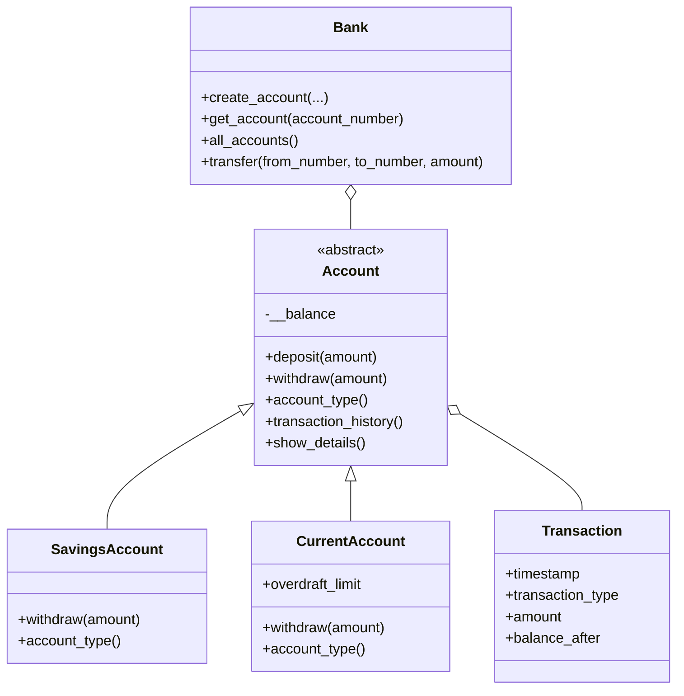

# Python Banking System — OOP Project

A menu-driven Python project demonstrating object-oriented programming concepts.

## Features
- Create savings and current accounts
- Deposit, withdraw, and transfer money
- View account details and transaction history
- List all accounts
- Validate input, prevent duplicate account numbers, and handle errors
- Apply different withdrawal rules to savings and current accounts

> **Educational project:** Account and transaction data are held in memory and are lost when the program exits. Do not use this for real banking or real customer data.

## Requirements
- Python 3.9 or later
- No external libraries

## Run
Open a terminal in this folder and run:

```bash
python banking_system.py
```

## OOP concepts
- **Classes and objects:** `Bank`, `Account`, `SavingsAccount`, `CurrentAccount`, `Transaction`
- **Constructor:** `__init__()` initializes each object.
- **Encapsulation:** `Account` stores its balance in private `__balance`, exposed through a read-only property.
- **Abstraction:** `Account` is an abstract class with abstract `withdraw()` and `account_type()` methods.
- **Inheritance:** Savings and current accounts inherit from `Account`.
- **Polymorphism:** Each account subclass implements its own withdrawal rules.
- **Exception handling:** Invalid values and missing or duplicate accounts produce readable error messages.

## Class diagram



## Suggested test
1. Create savings account `1001`, name `Asha`, opening balance `1000`.
2. Deposit `500` into account `1001`.
3. Withdraw `200` from account `1001`.
4. View its details and transaction history.
5. Create current account `2001` with opening balance `100` and overdraft limit `500`.
6. Transfer `300` from account `1001` to `2001`.
7. Try an over-limit withdrawal and confirm an error is displayed.

## Files
- `banking_system.py` — program source
- `README.md` — setup, concepts, and class diagram
- `architecture.md` — separate architecture document
- `.gitignore` — ignores Python cache and virtual environments
