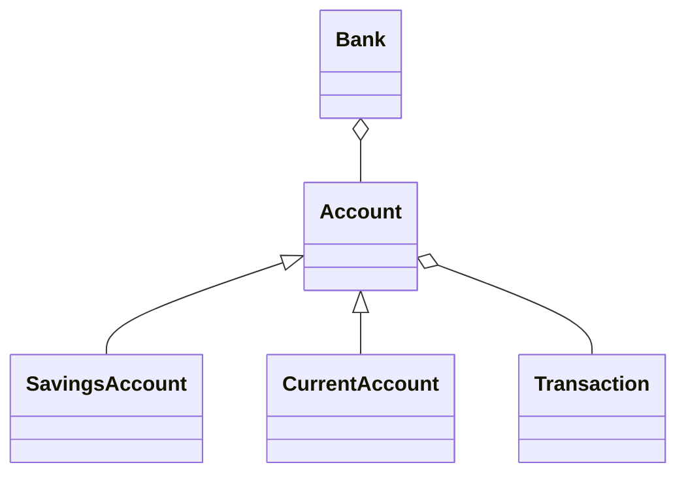

# Banking System Architecture

## Overview
The console interface in `banking_system.py` reads menu choices and calls methods on a `Bank` object. The bank manages account objects, and each account records its transactions.

## Classes
- **Account (abstract):** Shared account details, private balance, deposit behavior, validation, and transaction history.
- **SavingsAccount:** Prevents withdrawals larger than the available balance.
- **CurrentAccount:** Allows withdrawals up to the balance plus its configured overdraft limit.
- **Transaction:** Stores the date/time, transaction type, amount, balance after the transaction, and an optional note.
- **Bank:** Creates accounts, looks them up, lists them, and coordinates transfers.

## Class diagram

## OOP principles demonstrated
- **Encapsulation:** The balance is private and exposed through a read-only property.
- **Abstraction:** `Account` declares required methods using `ABC` and `@abstractmethod`.
- **Inheritance:** Both account types reuse the base class.
- **Polymorphism:** Withdrawal behavior depends on the concrete account type.
- **Composition/aggregation:** A bank manages account objects; accounts keep transaction records.

## Limitations and improvements
The current version keeps data in memory, so records disappear after exiting. Future improvements could add SQLite storage, login authentication, unit tests, and a graphical interface. This project is for learning and is not production banking software.
